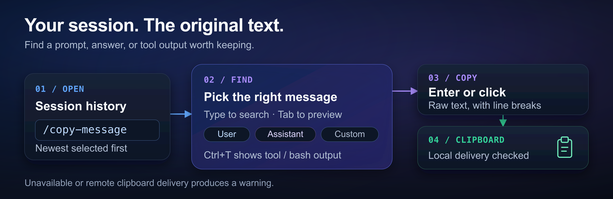

# pi-copy-message

Copy any message from your [Pi](https://github.com/earendil-works/pi-mono) session with a searchable picker. Get the original message text, including code and line breaks, without terminal wrapping or UI decoration.



*Find a message in your session, then copy its text; local clipboard readback checks delivery.*

## Install and start

Requires **Pi 1.0.0 or later** and **Node.js 24.15.0 or later**.

```bash
pi install npm:pi-copy-message
```

Start Pi, or run `/reload` in an open session. Then enter:

```text
/copy-message
```

Type a few words to find a message, use **↑ / ↓** to select it, and press **Enter** to copy. The newest visible message is selected when the picker opens.

Prefer GitHub? Use `pi install https://github.com/fitchmultz/pi-copy-message` instead. Restart Pi after changing dependencies or the host runtime.

## Quick copies

Use these commands inside Pi when you already know what you want:

| Command | What it copies |
|---|---|
| `/copy-user` | Your most recent message with text |
| `/copy-message latest` | The latest default-visible message in Pi's active context |
| `/copy-message 3` | The third default-visible message in branch history, counted oldest to newest |
| `/copy-message latest --with-meta` | The latest message with its role and local time, when available |

`last` and `newest` are aliases for `latest`. `--with-metadata` and `--with-role` are aliases for `--with-meta`; the flag also works with `/copy-user` and numbered copies.

**History and active context differ:** the picker, numbered copies, and `/copy-user` use stored messages on the current branch, including older pre-compaction history. `latest` uses Pi's active context, honoring context edits, omissions, and compaction.

## Find the right message

The picker lists messages oldest to newest. User, assistant, and visible custom messages appear by default; tool and bash messages stay hidden until you enable them.

- **Type or paste text** to search roles and message text. Search is case-insensitive; every word must match. Use `time:<term>` to search displayed timestamps.
- **Ctrl+U / Ctrl+A / Ctrl+T** toggle user, assistant, and tool/bash messages. **Alt+C** toggles custom messages.
- **Tab** opens a wrapped preview. **Alt+M** switches between raw text and text with role/time metadata.
- **Enter** copies the selection; **Esc / Ctrl+C** cancels. You can also scroll with the mouse wheel and click a message to copy it.

Navigation, confirm, and cancel follow your configured Pi selection bindings. The picker shows your active key hints; those bindings take precedence over its shortcuts.

See the [full keyboard controls and behavior reference](https://github.com/fitchmultz/pi-copy-message/blob/main/docs/reference.md) for page jumps, fullscreen controls, and selection details.

## Clipboard behavior

Copied text keeps the stored message's code, spacing, and line breaks. Previews and notifications remove terminal control characters for safe display; the clipboard text stays raw. Copying or cancelling returns you to your unchanged draft.

The extension uses Pi's clipboard support, including its OSC 52 terminal fallback. A **Copied** notification means local clipboard text was read back and matched. If delivery cannot be verified, you get a warning; a failed write reports an error. Remote terminal delivery cannot be verified, even when the remote machine's local clipboard matches.

The picker requires interactive TUI mode. Direct commands (`/copy-user`, `latest`, and numbered copies) also work outside TUI mode, where notifications may not be shown. More [platform and delivery details](https://github.com/fitchmultz/pi-copy-message/blob/main/docs/reference.md#clipboard-delivery) are in the reference.

## More

- [Reference](https://github.com/fitchmultz/pi-copy-message/blob/main/docs/reference.md) — all controls, message selection, and platform notes.
- [Development](https://github.com/fitchmultz/pi-copy-message/blob/main/docs/development.md) — tests, host qualification, and maintainer release procedure.
- [Changelog](CHANGELOG.md) — release history.
- [Issues](https://github.com/fitchmultz/pi-copy-message/issues) — report a problem or suggest an improvement.

Pi's built-in **Ctrl+X** copies the latest assistant response. This extension adds searchable history, other roles, metadata, and direct selectors. It supersedes [pi-copy-user-message](https://github.com/fitchmultz/pi-copy-user-message), which only copied the most recent user message.

## License

[MIT](LICENSE) · Mitch Fultz
